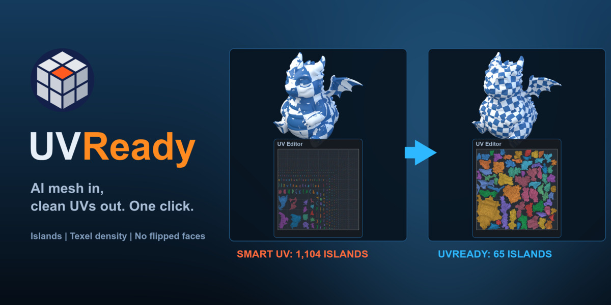
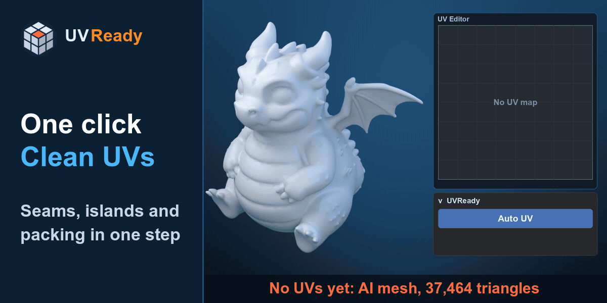
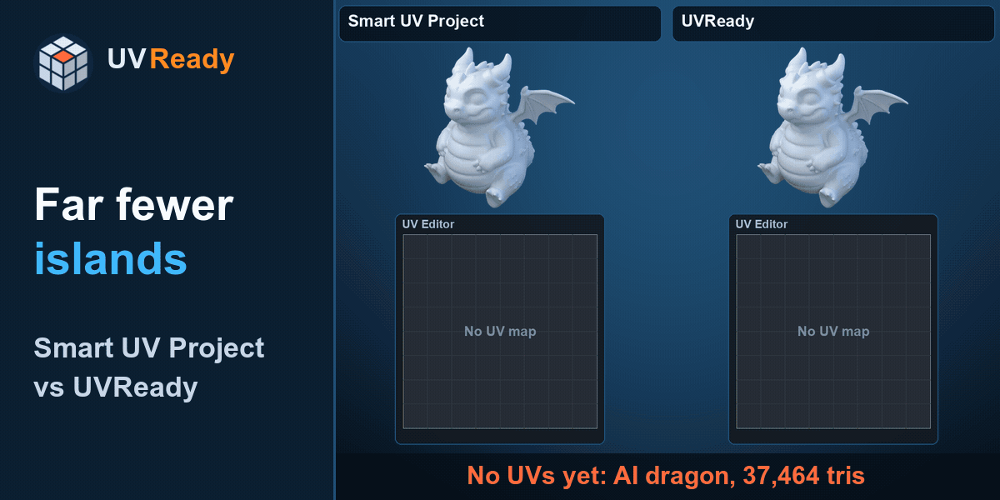
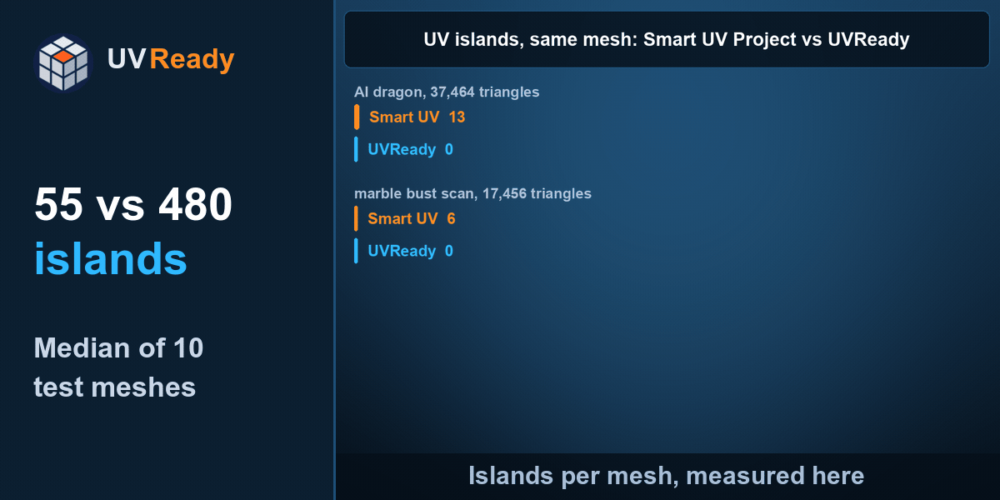
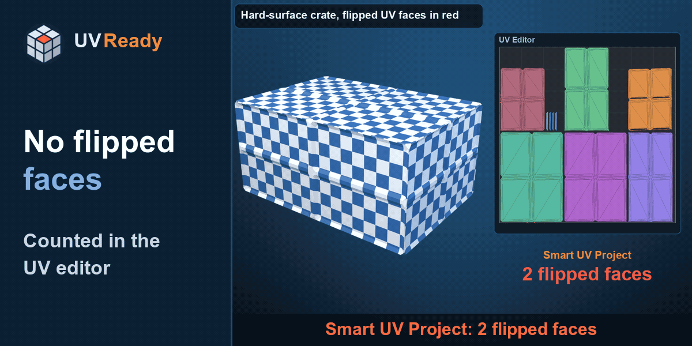
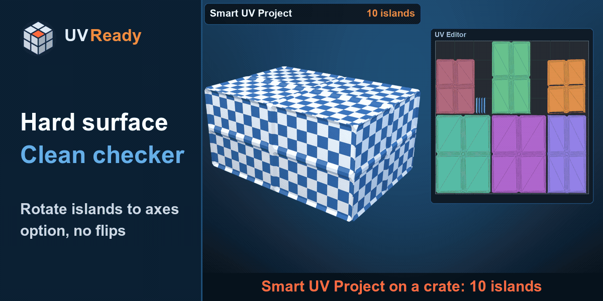
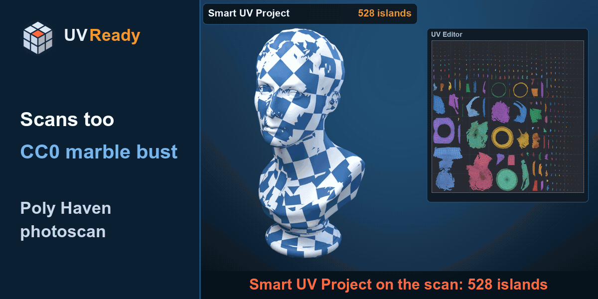
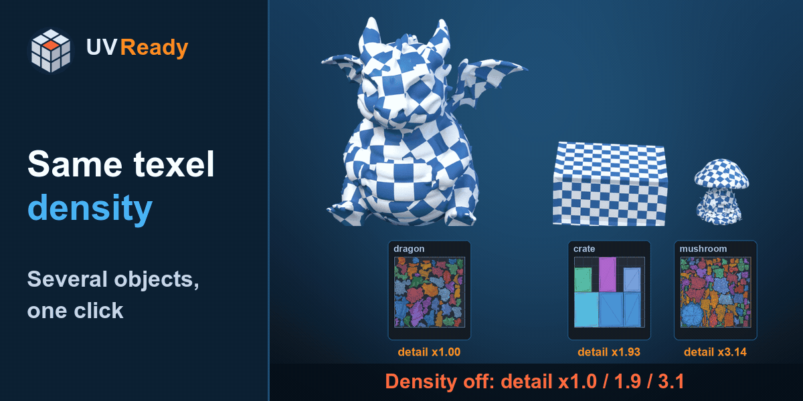

# UVReady Lite - One Click Auto UV Unwrap for Blender (free add-on for AI, scanned and sculpted meshes)

UVReady Lite is a free, open-source Blender add-on that unwraps a mesh with one button. It places the seams, unwraps every island, repairs flipped UV faces and packs the layout, in one undoable step. It is made for meshes that have no usable UVs: AI-generated models (Meshy, Tripo, Hunyuan3D, TRELLIS), photogrammetry scans and dense sculpts, where Blender's Smart UV Project cuts the mesh into hundreds of tiny islands. For Blender 4.2 LTS, 4.5 LTS and 5.x.

**Works on Windows, macOS and Linux.**

[Download the latest release](https://github.com/mendbox/uvready-lite/releases/latest)

**Get the full UVReady: unwrap all selected objects at once with one texel density, plus margin, texture size, rotate-to-axes and replace-UV-map settings → [Gumroad](https://mendbox.gumroad.com/l/uvready)**

## What Lite does

### One click

*Select a mesh in Object Mode, press Auto UV. A new UV map "UVReady" is added and made active; your existing UV maps are kept. One Ctrl+Z (Cmd+Z) undoes it. (The animations show the full version's panel; Lite has the same button with the default settings.)*

### AI meshes get usable UVs

*An AI-generated model with shattered UVs, before and after one click.*

### Few islands, low stretch

*On our 10 test meshes UVReady gives a median of 55 islands where Smart UV Project (66 degrees) gives 480. The result box shows the island count and the stretch (low, medium or high) after every run.*

### No flipped faces

*Flipped UV faces are repaired: 0 flipped faces on all 12 of our test meshes and on 5 scans.*

### Flat and hard-surface parts

*Flat and bent-sheet regions unfold exactly and creases are used as seams. (Turning the islands to the X and Y axes is a full-version setting.)*

### Scans and sculpts

*Tested on 5 real scans: 0 flipped faces, no overlap, 13 to 110 times fewer islands than Smart UV.*

## Lite vs Full

| Feature | Lite (free) | Full (paid) |
|---|:---:|:---:|
| One-click seams, unwrap, flip repair, packing, one undo step | yes | yes |
| New UV map, existing maps kept; result box with islands and stretch | yes | yes |
| Objects per click | 1 (the active one) | all selected |
| Match texel density across objects | - | yes |
| Margin and texture size | 4 px on 2048 | 0-64 px on 512-8192 |
| Rotate islands to axes (straight packing for hard-surface) | - | yes |
| Replace the active UV map instead of adding one | - | yes |
| Face limit per object | 200,000 | adjustable up to 2,000,000 |
| Windows, macOS, Linux | yes | yes |

*The full version: many objects in one click, with the same texel density.*

## Install (Blender 4.2 and newer)

1. Download `uvready_lite-1.0.0.zip` from [Releases](https://github.com/mendbox/uvready-lite/releases/latest). **Do not unzip it.** Safari on macOS unzips downloads automatically: turn off "Open safe files after downloading" in Safari settings, or use another browser.
2. **Edit > Preferences > Get Extensions**, arrow menu at the top right, **Install from Disk**, pick the zip.
3. Select your mesh in Object Mode, press `N`, open the **UVReady Lite** tab, press **Auto UV**.

Lite and the full UVReady can be installed at the same time: each has its own sidebar tab, and Lite does not touch the full version's settings.

## Platforms

Works on Windows, macOS and Linux. Pure Python, no compiled parts. Tested headless on Blender 4.2, 4.5 and 5.2 on macOS, Windows and Linux. Offline: no internet, no AI service, no other software.

## What it does NOT do

- Auto seams overwrite the seams you already marked on the object (UV maps are kept, seams are not).
- It runs inside Blender and blocks it while it works: about 15 seconds for 150,000 triangles. Meshes over 200,000 faces are skipped; decimate them first.
- A mesh made of hundreds of separate pieces gives hundreds of islands. Round parts (tori, hoops) come out as arcs.
- No UDIM, no symmetry, no manual seam editing. Each object gets its own 0-1 UV square (no shared atlas).

## License

GPL-3.0-or-later.

## Support

support@mendboxstudio.com. Update notices and new add-ons by email: https://mendboxstudio.com/updates

---

**Need many objects at once, one texel density and full control of margin and packing? Get the full UVReady → [Gumroad](https://mendbox.gumroad.com/l/uvready)**
